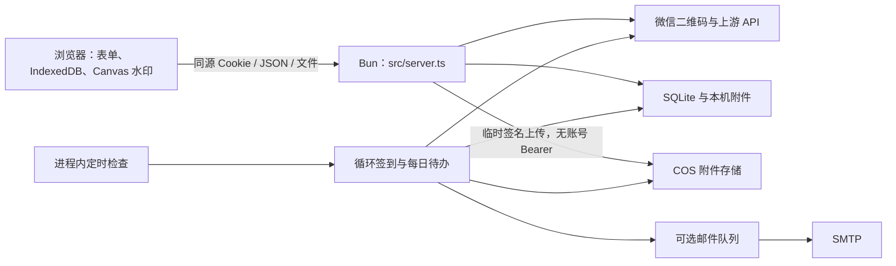

# 接龙工作台：项目说明与 AI 交接文档

交接日期：2026-11-24，业务时区：`Asia/Shanghai`。原始行为版本为 `fe29008`；2026-11-27 补充跨设备登录续期行为。后续修改以源码、测试和用户最新要求为准。

这是一个可独立运行的本地 Web 项目。阅读本文件不需要原聊天记录，也不需要取得真实账号凭证。用户使用 `jielong-hack` 作为目录名，应用名称与包名分别为“接龙工作台”和 `jielong-studio`。

## 目录

1. [目标与已经确认的约定](#1-目标与已经确认的约定)
2. [启动与配置](#2-启动与配置)
3. [架构与源码导航](#3-架构与源码导航)
4. [数据结构与身份边界](#4-数据结构与身份边界)
5. [微信登录与任务发现](#5-微信登录与任务发现)
6. [表单与手动提交](#6-表单与手动提交)
7. [附件上传与水印](#7-附件上传与水印)
8. [循环签到与每日待办](#8-循环签到与每日待办)
9. [可选邮件通知](#9-可选邮件通知)
10. [本站 HTTP API](#10-本站-http-api)
11. [开发、测试与联调](#11-开发测试与联调)
12. [运行维护与排障](#12-运行维护与排障)
13. [已知限制与可改进项](#13-已知限制与可改进项)
14. [版本、协议证据与接手步骤](#14-版本协议证据与接手步骤)

## 1. 目标与已经确认的约定

项目参考 `school_checkin` 的微信扫码、自动签到和邮件通知流程，独立实现一个集中编辑和提交任务的工作台。参考项目在原开发机器的 `/Users/adlb/Code/WebProjects/school_checkin`，运行本项目不依赖该路径，不会自动读取它的 `.env`。

### 1.1 已实现范围

| 能力         | 当前行为                                                                         |
| ------------ | -------------------------------------------------------------------------------- |
| 登录         | 微信二维码登录，服务端保存上游凭证                                               |
| 任务列表     | 查看参与、发布、收藏中的接龙、签到和周期打卡，保留原始分页                       |
| 手动添加     | 支持最终任务链接、短 ID、数字 ThreadId、官方分享重定向链接                       |
| 手动添加分类 | 独立展示、按规范化 ThreadId 去重、同一微信账号跨会话保留                         |
| 表单         | 动态加载字段，编辑文本、选项、数字、日期、位置及附件；部分复杂字段提供 JSON 编辑 |
| 已有记录     | 读取本人记录，只有上游允许编辑时才修改                                           |
| 水印         | 浏览器 Canvas 合成，预览、下载、作为普通图片附件上传                             |
| 手动提交     | 本机暂存 → 验证并上传附件 → 最终预览 → 确认提交                                  |
| 循环签到     | 周期打卡的每日调度、待办编辑、昨日内容复制、登录恢复后当天补交                   |
| 通知         | 始终可用的站内状态，以及可选 SMTP 邮件                                           |
| 演示         | 三个本地虚拟任务，模拟提交与循环签到，不发送真实表单或邮件                       |

### 1.2 不能随意改变的约定

- `ThreadType=0` 是接龙，`5` 是周期打卡，`90` 是签到；`0/90` 使用 FeedBack 协议，`5` 使用 CheckIn 协议。其他任务类型暂时不是主要适配对象。
- `listType` 是任务列表来源，当前仅使用 `1=参与、2=发布、5=收藏`。不要与 `ThreadType` 混用，也不要重新引入之前被平台拒绝的列表枚举。
- 手动输入任务必须进入“手动添加”分类，不能仅临时打开而丢失保存记录。详情页展示规范化后的 ThreadId。
- **邮箱可选**。收件地址不完整、未填写，或 SMTP 必需配置缺失时，自动签到仍可使用，退回站内查看结果和扫码续期。
- 自动签到默认北京时间 18:00。每日待办默认复制**本人昨天**的内容，不能取任意人的记录，也不能把“最近一次”当作“昨天”。
- 修改待办只改变未来要提交的内容，不能直接覆盖昨天或其他历史签到。
- 登录恢复只补交当天；到 23:00 停止当天补交。后台不会补交往日记录。
- `unknown` 表示提交结果不明，应先核对官网；不能为了“提高成功率”自动重发或清掉已提交标记。
- 用户已确认当前水印样式：黄色圆标、白色“接龙管家”、下方浅色半透明底上的“真实时间”镂空字。相关需求已反复比对，普通重构不应重新设计。

## 2. 启动与配置

### 2.1 技术栈与命令

| 项目           | 实现                                                               |
| -------------- | ------------------------------------------------------------------ |
| 依赖管理       | pnpm，锁文件为 `pnpm-lock.yaml`                                    |
| 服务端         | Bun 原生 `Bun.serve`、TypeScript、`bun:sqlite`                     |
| 前端           | 原生 TypeScript、HTML、CSS；没有 React、Vue、Vite 或前端路由库     |
| 打包           | `Bun.build`，入口 `src/client/app.ts`，产物 `public/assets/app.js` |
| 媒体检测       | `sharp` 检测图片，`ffprobe` 检测视频与音频                         |
| 邮件           | Nodemailer                                                         |
| 格式与静态检查 | Antfu ESLint、TypeScript strict                                    |
| 测试           | `bun test`，由 `bunfig.toml` 预加载隔离环境                        |

README 要求 Bun 1.3+；交接机器实际使用 Bun 1.4.4、Node v22.23.4、pnpm 12.18.0。它们是验证环境记录，并非已经用 `engines` 强制锁定的版本。

在仓库根目录执行：

```sh
pnpm install
pnpm run dev
```

默认访问 `http://127.0.0.1:3210`。`pnpm run start` 也从 TypeScript 源码启动服务；启动时自动构建客户端。`pnpm run build` 只构建浏览器资源，不生成独立的服务端可执行文件或 `dist` 服务。

`bun --watch` 用于服务重启，不提供浏览器 HMR。改动源码或样式后刷新浏览器。启动用户现有数据目录的服务会恢复已经启用的循环计划；开发预览应使用隔离目录，见第 11 节。

### 2.2 环境变量

Bun 启动时读取 `.env`。可按需复制 [`.env.example`](../.env.example)，不需要 SMTP 配置也能启动。配置变更后重启服务，特别是已经创建过的 SMTP transport 不会随页面刷新重建。

| 变量               | 默认值 / 作用                                                         |
| ------------------ | --------------------------------------------------------------------- |
| `HOST`             | `127.0.0.1`，监听地址                                                 |
| `PORT`             | `3210`，监听端口                                                      |
| `JIELONG_DATA_DIR` | 仓库 `.local/`，SQLite 与附件所在目录；自定义时建议使用绝对路径       |
| `WECHAT_APP_ID`    | `wx4a23ae4b8f291087`，沿用参考项目的微信开放平台应用 ID               |
| `FFPROBE_PATH`     | `ffprobe`，可使用可执行文件的绝对路径                                 |
| `PUBLIC_ORIGIN`    | 可选，对外访问的完整 origin；用于写请求来源校验与 HTTPS Secure Cookie |
| `BASE_URL`         | 邮件链接优先使用此 origin；其次 `PUBLIC_ORIGIN`，最后回退本机地址     |
| `NODE_ENV`         | `production` 时启动构建启用压缩；不切换数据库或计划状态               |
| `SMTP_HOST`        | SMTP 主机，示例为 `smtp.qq.com`；缺失则站内模式                       |
| `SMTP_PORT`        | 默认 `465`                                                            |
| `SMTP_SECURE`      | 未设置时由端口是否为 465 决定；显式设置时仅字符串 `true` 表示启用     |
| `SMTP_USER`        | SMTP 登录用户，同时作为发件地址                                       |
| `SMTP_PASS`        | SMTP 密码或服务商授权码，不提交 Git                                   |
| `TO_EMAIL`         | 新计划的默认收件人，可为空；不会自动覆盖既有计划                      |
| `EMAIL_FROM_NAME`  | 默认“接龙工作台”                                                      |

`BASE_URL` 会取 URL 的 origin，路径部分不会保留；当前不支持部署在任意 URL 子路径下。无效的邮件站点地址会回退，不阻止站内功能。只配置 `BASE_URL` 不会改变监听地址、公开网络服务或放宽来源校验。

视频、音频需要 PATH 中可找到 `ffprobe`，或通过变量指定。macOS 可以按需使用 `brew install ffmpeg`。当前浏览器图片入口主要接受 JPEG、PNG、WebP，服务端额外具备部分图片格式识别能力，不能据此宣称前端支持所有图片格式。

## 3. 架构与源码导航



### 3.1 文件地图

| 路径                                                            | 职责 / 关键入口                                                                  |
| --------------------------------------------------------------- | -------------------------------------------------------------------------------- |
| [`src/server.ts`](../src/server.ts)                             | 服务启动、静态资源白名单、会话、同源检查、全部本站路由、手动预览 Map、调度定时器 |
| [`src/shared.ts`](../src/shared.ts)                             | `Thread / Field / RecordValue / FormSchema / Draft`、字段名称、默认值            |
| [`src/automation-shared.ts`](../src/automation-shared.ts)       | `CheckinPlan / DailyCheckin / RunStatus` 和中文状态标签                          |
| [`src/lib/api.ts`](../src/lib/api.ts)                           | 上游请求、业务成功判定、`AppError`、查询参数构造                                 |
| [`src/lib/auth.ts`](../src/lib/auth.ts)                         | 微信二维码与轮询、用户摘要、稳定账号 key                                         |
| [`src/lib/thread-reference.ts`](../src/lib/thread-reference.ts) | 链接解析、分享跳转检查、短 ID 到真实 ThreadId                                    |
| [`src/lib/forms.ts`](../src/lib/forms.ts)                       | 列表、记录摘要、动态表单、字段验证、上游 payload                                 |
| [`src/lib/media.ts`](../src/lib/media.ts)                       | 本机暂存、媒体限制、COS 临时策略与上传、附件白名单                               |
| [`src/lib/store.ts`](../src/lib/store.ts)                       | SQLite 初始化、会话、历史、媒体、手动添加分类                                    |
| [`src/lib/automation-store.ts`](../src/lib/automation-store.ts) | 自动签到凭证、计划、每日记录、版本校验与中断恢复                                 |
| [`src/lib/automations.ts`](../src/lib/automations.ts)           | `AutomationService`：创建计划、生成待办、保存、暂停、执行、通知                  |
| [`src/lib/checkin-calendar.ts`](../src/lib/checkin-calendar.ts) | 北京日期、前后日、计划时间、23:00 截止、记录日期                                 |
| [`src/lib/checkin-records.ts`](../src/lib/checkin-records.ts)   | 按业务日期查找本人打卡，必要时读取记录详情                                       |
| [`src/lib/mail.ts`](../src/lib/mail.ts)                         | 可选配置、HTML 与文本邮件、持久化队列、退避与去重                                |
| [`src/lib/demo.ts`](../src/lib/demo.ts)                         | 三个虚拟任务与表单                                                               |
| [`src/client/app.ts`](../src/client/app.ts)                     | 前端状态、页面模板、事件委托、登录、表单、预览、自动签到界面                     |
| [`src/client/helpers.ts`](../src/client/helpers.ts)             | 同源请求、转义、URL 过滤、图标、IndexedDB                                        |
| [`src/client/watermark.ts`](../src/client/watermark.ts)         | 既定水印样式、时间格式、Canvas 合成与 JPEG 输出                                  |
| [`public/index.html`](../public/index.html)                     | HTML 入口                                                                        |
| [`public/styles.css`](../public/styles.css)                     | 界面与响应式样式                                                                 |
| [`public/watermark-logo.webp`](../public/watermark-logo.webp)   | 已纳入项目的用户提供 Logo，不依赖下载目录                                        |
| [`tests/`](../tests/)                                           | 协议、持久化、自动签到、通知与本地集成测试                                       |

### 3.2 前端状态维护

页面通过模板字符串和 `shell()` 重建，交互集中在 document 的 `click/input/change` 事件委托中。新增按钮使用 `data-action`，字段通过 `data-field` 标识。动态内容使用 `esc()`，附件展示地址使用 `safeUrl()`。

主要状态为 `view、schema、draft、locals、watermark、prepared、scheduled`。`scheduled` 非空时，同一表单编辑器进入自动签到待办模式，必须调用自动签到保存接口，不能走手动 `prepare/submit`。

`loginEpoch / previewEpoch / taskLoadEpoch` 防止旧异步结果覆盖当前页面；`releaseUrls()` 负责释放图片 Blob URL。拆分前端模块时应保留这些行为，以及切换任务前保存草稿、成功后清理草稿的顺序。

## 4. 数据结构与身份边界

### 4.1 领域模型

| 模型           | 要点                                                                                                 |
| -------------- | ---------------------------------------------------------------------------------------------------- |
| `Thread`       | 本站使用字符串 `id`，另有标题、作者、数值任务类型、开放状态等                                        |
| `Field`        | 上游动态设置；至少含 `Id / Name / FieldType`，还可能有必填、隐藏、只读及限制属性                     |
| `RecordValue`  | 以 `FieldId` 对应字段；值分布在 `Values / Texts / Files`，保留矩阵等扩展结构                         |
| `FormSchema`   | 归一化后的任务、字段、已有值、署名、编号、上传限制、提交许可、隐私确认要求和上游 endpoint            |
| `Draft`        | `signature / number / values`；不是可直接任意发送给上游的 payload                                    |
| `CheckinPlan`  | 一个账号的一个任务，含时间、收件邮箱、开关、表单快照与隐私指纹                                       |
| `DailyCheckin` | `planId + date` 对应的独立待办和执行结果，含 draft、schema、source、revision、status、submittedAt 等 |

记录 ID 可能超出 JavaScript 安全整数范围，不能统一 `Number(recordId)`。本站编辑路由接受 1–24 位数字字符串。当前上游 payload 的数字 ThreadId 仍转换为 Number；大整数 ThreadId 的完整适配属于后续工作，不能把“记录 ID 已保留字符串”理解成所有 ID 都已无精度风险。

### 4.2 会话、账号与 owner

| 范围                   | owner / key                                               | 生命周期                       |
| ---------------------- | --------------------------------------------------------- | ------------------------------ |
| 网页会话               | 随机 `session.id`                                         | 独立于 Token，按访问续期一年   |
| 真实账号               | `wechat:` 加上 CurrentUser 的 `Id` 或 `OpenId` 的 SHA-256 | 同一微信账号跨会话稳定         |
| 演示账号               | `demo:<session.id>`                                       | 仅该演示会话稳定               |
| 手动提交历史与暂存附件 | `session.id`                                              | 不自动迁移到新的网页会话       |
| 手动添加任务           | 稳定账号 key                                              | 同一真实账号重新登录后保留     |
| 自动签到计划与账号凭证 | 稳定账号 key                                              | 凭证供已绑定网页会话与后台共享 |
| 自动签到历史与附件     | `automation:<稳定账号 key>`                               | 同一真实账号跨会话可用         |

`GET /api/auth/me` 的 `scope` 是 session ID 的摘要，用于浏览器草稿隔离，不是稳定账号 key，也不是登录凭证。不能用客户端传来的账号标识决定数据归属。

### 4.3 SQLite 与文件

数据目录在 `store.ts` 导入时创建，目录权限 0700，`state.sqlite` 权限 0600，启用 WAL。业务 JSON 通常保存在表的 `data TEXT` 列。

| 表                    | 主键 / 唯一约束                       | 用途                                                                                |
| --------------------- | ------------------------------------- | ----------------------------------------------------------------------------------- |
| `sessions`            | `id`                                  | 会话 JSON 与设备记忆期限；`expire` 是 Token 期限，`sessionExpiresAt` 是独立会话期限 |
| `history`             | `id`                                  | 提交结果，按 owner 查最近 100 条                                                    |
| `media`               | `id`                                  | 附件 owner、元数据、磁盘路径                                                        |
| `drafts`              | `(owner, thread)`                     | 预留的服务端普通草稿辅助函数；当前普通编辑器实际使用 IndexedDB                      |
| `saved_threads`       | `(owner, thread_id)`                  | 手动添加任务，重复添加更新摘要但保留创建顺序                                        |
| `automation_accounts` | `owner`                               | 同账号网页与后台共享的最新凭证快照，不包含二维码轮询 login 对象                     |
| `checkin_plans`       | `id`，另有 `UNIQUE(owner, thread_id)` | 自动签到计划，每账号最多保存 50 个                                                  |
| `daily_checkins`      | `(plan_id, date)`                     | 每日 schema/draft/结果；另有 `status / revision` 列用于状态与版本检查               |
| `mail_outbox`         | `id`                                  | 通知内容、收件人、状态、尝试次数、下次发送时间与脱敏错误                            |

附件字节位于 `<数据目录>/media/<UUID>`，真实路径只保存在服务端元数据。SQLite 初始化分散在 `store.ts / automation-store.ts / mail.ts` 的 `CREATE TABLE IF NOT EXISTS` 中，当前没有独立迁移框架。新增字段或约束需兼容已有数据，不能用删库代替迁移。

### 4.4 浏览器草稿

IndexedDB 数据库 `jielong-studio`，版本 1，对象仓库 `drafts`。普通草稿 key 由 `scope + threadId + recordId` 构成，自动签到草稿还包含 `automatic + planId + date`。

暂存内容包含 draft、本地 File 对象、水印设置、字段结构摘要；自动签到另存服务端 revision、时间、收件人和隐私勾选。只有字段结构一致、自动签到 revision 未变时才恢复暂存，避免覆盖后台已更新的待办。

输入后约 500ms 暂存。**浏览器暂存不等于后台待办已更新**；自动签到必须显式保存到服务端才生效。清理浏览器数据会丢失尚未保存的内容，但不会删除 SQLite 中的计划与待办。

## 5. 微信登录与任务发现

### 5.1 登录链路

1. `startLogin()` 请求微信开放平台 `connect/qrconnect`，使用应用 ID、`snsapi_login` scope 和固定的接龙官网登录回调地址。
2. 从响应页面解析 UUID，二维码有效期按本机约 5 分钟记录。本站 `/api/auth/qr` 代理二维码图片。
3. `pollLogin()` 调用微信长轮询接口：404 表示已扫码、405 携带授权 code，402/403/666 视为过期。
4. 使用 code 请求上游 `/api/User/OpenAuth`，再请求 `/api/User/CurrentUser`，保存 Bearer、有效期、公开用户摘要与稳定账号 key。
5. 仅在二维码首次完成登录时调用 `automations.registerLogin()` 更新账号共享凭证，并触发一次调度检查，是否补交仍受当天时段与去重约束。重复轮询已成功的二维码不重新登记旧凭证；普通待办保存也不能覆盖已登记的账号凭证。

Token 有效期优先使用上游响应，可解析秒、毫秒或日期字符串；无法识别时当前实现回退约 72 小时。不能把 72 小时写成平台保证，远端拒绝登录时仍需重新扫码。

Cookie 为 `jielong_session`，HttpOnly、SameSite=Strict，每次 API 访问将 Cookie 与服务端 `sessionExpiresAt` 续期一年。设置 HTTPS `PUBLIC_ORIGIN` 时增加 Secure。Token 的 `expire` 只决定是否能访问上游，不再让设备忘记已验证账号。

每次 API 请求先用服务端会话内已验证的 `accountKey` 读取 `automation_accounts`，只同步 Token、有效期与公开用户摘要，保留当前设备的 session ID、普通草稿/附件归属与二维码状态。同一服务上任意设备重新扫码后，其他已绑定该微信的设备下一次请求即使用最新凭证；即使旧 Token 尚未到期，也会切换。账号最新凭证过期或被上游拒绝时，保留会话与账号信息并返回未认证状态；失效页面在返回前台或约 30 秒轮询时检查恢复，编辑器内容不被重建。

兼容旧数据：旧会话没有 `sessionExpiresAt`、但具有真实账号 `accountKey` 时，首次读取保留账号绑定并补上独立期限，包括旧 Token 已过期的记录。不需要清库或迁移真实数据目录。此兼容依赖浏览器仍持有原会话 Cookie；旧版已把 Cookie 替换成匿名会话、用户主动退出/清理 Cookie，或访问另一套独立数据目录的服务时，仍须重新扫码。客户端传入的昵称、账号 ID 或其他本地展示信息不能用于认领账号。

上游明确拒绝登录时，仅失效与失败请求 Token 匹配的凭证，防止旧请求迟到的失败响应使其他设备的新登录失效。提交请求不因此自动重放，继续保留既有 `unknown` 与去重规则。

退出会删除当前网页会话、对应普通服务端草稿和内存预览，并清除当前 Cookie；已退出设备不能自动恢复。它**不影响其他设备的登录、不删除手动添加任务，也不停止自动签到计划**；用户应通过暂停开关停止后续执行。

### 5.2 输入解析

`parseThreadReference()` 支持数字 ThreadId、1–64 位字母数字短 ID，以及官方 URL 中的这些形式：

- `/fb/<id>`、`/c/<id>`。
- 带 `threadId` 或 `ThreadId` 查询参数的任务地址。
- `#/...` hash 路由。
- `jielong.com/s/...` 这类公开分享跳转地址。

URL 中的 `fb` 倾向 FeedBack，`c` 倾向 CheckIn。裸短 ID 先尝试 FeedBack 详情，只有上游业务错误时才尝试 CheckIn；登录错误和网络错误不会被当作“换个类型再试”。数字 ThreadId 不需要通过短 ID 详情再次转换。

短 ID 转换读取 `Data.Thread.ThreadId` 或 `Data.ThreadId`。必须保存返回的真实 ID，不能用短 ID 或 URL 文本作为去重键。

分享参数视为不透明字符串，不通过自行解码 Base64 猜测任务 ID。公开跳转最多请求五次，使用 `redirect: manual`；逐跳检查 HTTPS、无 URL 凭证、无自定义端口，域名限 `jielong.com / www.jielong.com / i.jielong.com`。请求不携带用户 Bearer 或 Cookie，遇到循环、无 Location、外部目标即拒绝。

### 5.3 列表与记录

任务列表 `/api/Thread/Threads` 每页 50 条，过滤后只展示 `ThreadType 0/5/90`，但 `Page` 仍使用上游原始分页，以免因为一页里其他任务类型较多而漏掉后续页。

普通“我的已有记录”当前只读取第一页最多 100 条，筛选 `IsCurrentUser === true`。这个入口的分页限制和自动签到的按日记录检索不同，不要混为一谈。

## 6. 表单与手动提交

### 6.1 上游接口对应

| 场景                  | 上游接口                                                    |
| --------------------- | ----------------------------------------------------------- |
| 判断任务类型          | `GET /api/Thread/SimpleDetail`                              |
| 接龙 / 签到详情       | `GET /api/FeedBack/ThreadDetail`                            |
| 接龙 / 签到编辑表单   | `GET /api/FeedBack/GetEditFeedBackRecord`                   |
| 接龙 / 签到新建及修改 | `POST /api/FeedBack/AttendFeedBack`                         |
| 打卡详情              | `GET /api/CheckIn/Detail`                                   |
| 打卡编辑表单          | `GET /api/CheckIn/EditRecordDetail`                         |
| 打卡新建及修改        | `POST /api/CheckIn/EditRecord`                              |
| 接龙记录列表          | `GET /api/FeedBack/GetPagingFeedBackRecords`                |
| 打卡记录列表与详情    | `GET /api/CheckIn/Records`、`GET /api/CheckIn/RecordDetail` |
| 上传策略              | `POST /api/Attachment/CosUploadPolicy`                      |

统一封装只允许向 `https://i-api.jielong.com` 请求 API，带当前服务端 Bearer，禁止自动跟随重定向，超时 25 秒。HTTP 200 不代表业务成功：必须通过 `assertApi()`，业务 `Type` 为字符串 `000001`，且没有显式失败字段。

HTTP 401/403 或业务 `Type=100000/100001` 归为 `AUTH_REQUIRED`；网络异常归为 `NETWORK_ERROR`；其他业务失败为 `UPSTREAM_ERROR`。未来适配上游错误码时，应保留“明确拒绝”和“提交结果不明”的区别。

### 6.2 schema 与验证

`loadSchema()` 依次解析任务、读取详情、读取编辑表单，适配 `FeedBackSetting / CheckInSetting / Setting / RecordSetting` 等设置结构。已有记录编辑需要核对记录 ID、`IsCurrentUser` 和编辑许可。内部 `base` 包含编辑所需凭证，通过 `publicSchema()` 移除后才返回浏览器。

`validateDraft()` 检查必填署名/编号、未知和重复字段、只读字段、有效选项、单选数量、多选范围、数值范围、文字长度、位置和附件数量，并归一化 `FieldType / FieldName / HasValue` 等属性。浏览器的输入限制不能代替服务端验证。

| FieldType            | 当前处理                                                |
| -------------------- | ------------------------------------------------------- |
| `0–4`                | 单选、多选、图文选项、下拉；选项必须来自 schema         |
| `5 / 6 / 7`          | 文本、数字、日期时间控件；数字和文本有专门限制检查      |
| `8 / 9 / 10 / 15`    | 图片、视频、文件、音频附件                              |
| `12 / 13 / 14`       | 说明、图片说明、分页，主要用于展示                      |
| `16`                 | 位置：`Values[0]` 是坐标 JSON 字符串，`Texts[0]` 是地址 |
| `19`                 | 浏览器签名画布生成图片附件                              |
| `25`                 | 水印相机，普通图片附件链路                              |
| 其他，包括矩阵与表格 | 保留结构化编辑入口和扩展字段，尚未逐类完整验证          |

位置示例仅说明结构：

```json
{
  "FieldId": 16,
  "Values": ["{\"latitude\":30.55,\"longitude\":104.06}"],
  "Texts": ["示例地点"],
  "Files": [],
  "HasValue": true,
  "OtherValue": ""
}
```

实际 FieldId 必须来自当前任务，不能照抄示例。经纬度必须为有限数值且在合法范围；设备定位授权由浏览器交互发起，当前不做 GCJ/WGS 等坐标系转换。

### 6.3 手动提交的两个阶段

1. 浏览器 `stageOutgoing()` 将 `Files[].ClientId` 对应的本地 File 暂存为服务端 `LocalId`；水印字段先在浏览器合成。
2. `/prepare` 重新读取 schema，验证隐私同意与 draft，验证所有附件归属，上传需要上传的文件到 COS，调用 `createPayload()`。
3. 服务端将 payload 放入内存 `prepared` Map，生成 10 分钟有效 key，返回可核对的预览。**此时可能已经上传附件，但尚未提交签到表单。**
4. 用户确认后 `/submit` 检查 key 所有者、任务和期限，再次读取 schema，比较字段、原值、署名和编号的指纹，并刷新 EditToken。
5. 发起上游表单请求，确认成功后记录历史；同一个成功 key 再次确认返回缓存结果，不重复发送。

内存状态按 `ready → validating → submitting → success` 推进；验证失败进入 `invalid`，提交结果不明确进入 `unknown`。`unknown` 不能再次提交同一 key。该 Map 不持久化，服务重启后需要重新准备预览；这不是持久化的上游幂等键。

接龙与签到修改仍用 `AttendFeedBack`，不是另造一个“修改水印”接口。`createPayload()` 对打卡额外设置 `DateTarget=''、MinuteTarget=-1、IsNameNumberComfirm=false`，并移除 `FeedbackItemId`。新建记录 `Id=0`，不会把昨日 recordId 或 EditToken 复制为今日记录的编辑目标。

## 7. 附件上传与水印

### 7.1 三种附件表示

| 表示                                       | 所在阶段               | 处理方式                                                               |
| ------------------------------------------ | ---------------------- | ---------------------------------------------------------------------- |
| `{ ClientId, ... }`                        | 浏览器未暂存的 File    | 从 `locals` 找到实际文件，不能发送给上游                               |
| `{ LocalId, ... }`                         | 本机服务端已暂存       | 按 owner 查本机文件、验证类型/限制，执行时上传 COS                     |
| `{ RelativePath, Url, TenantTypeId, ... }` | 上游已有附件或上传回调 | 必须匹配服务器持有的本字段附件白名单，采用服务器原件而非任意客户端 URL |

`stageMedia()` 单文件上限 100 MiB，HTTP 请求体上限为 105 MiB。图片用 sharp 读取元数据并限制输入像素；声明为视频或音频的文件使用 ffprobe，探测进程约 15 秒超时。字段上传配置和 `validateMedia()` 还会进一步限制大小、时长、类型和扩展名。

`MediaType` 为图片 1、视频 2、文件 3、音频 4。水印相机与签名都属于图片。不要把 `FieldType` 和 `MediaType` 混用。

### 7.2 COS 上传

每次上传重新获取策略，接龙/签到 `tenantTypeId=300216`，打卡为 `300221`，同时带文件名、任务关联 ID 与 `yunStore=2`。

策略必需键为 `Host / Key / Policy / ContentType / Algorithm / Ak / KeyTime / Signature / Callback`，映射到 COS multipart 表单。Host 限 HTTPS、无 URL 凭证、标准端口和 `.jielong.com / .myqcloud.com` 域名后缀；存储上传禁止重定向、超时 60 秒，**不发送用户 Authorization**，只使用临时签名。

上传成功回调仍须通过业务成功判定，并含 `RelativePath / Url / MediaType`。回填完整附件对象和宽高、时长等信息，不应只保留一个 URL。

自动待办保存时会将当前会话本机附件登记到稳定账号的 `automation:` owner，复用同一份磁盘文件；执行时即使网页会话改变仍可访问。不能移除 owner 检查以“修复附件不存在”。

### 7.3 已确认水印的实现细节

源码为 `watermark.ts`，当前 `WATERMARK_RENDER_VERSION='jielong-camera-reference-v6'`。浏览器端渲染，没有独立服务端水印渲染器。

- 长边最多 2560 像素，保持原比例，不放大小图；输出 JPEG，质量参数 0.94。
- 左侧为时间、地点、经纬度，可选标题；时间按北京时间解析，中文与数字分段选用不同字体。
- 右侧从已入库 Logo 生成黄色圆标和白色字标，按参考图重新排列、对齐。
- “真实时间”先画在独立图层，再用 `destination-out` 挖空字形，最终透出照片；不是黑底白字，也不是把最终照片擦成透明。
- 预览容器可能因 `object-fit` 显示留边，Canvas 导出保持源图比例，不自动添加预览背景。源文件自身已有黑边则仍保留。
- 待办复制已上传照片时复用原附件，不会自动更新照片中已经烘焙的日期、水印或位置。需要改变时重新选择图片生成。

客户端的本机暂存缓存指纹包含水印配置和渲染版本。修改渲染算法时同步更新版本，否则可能继续使用上一次合成的文件；另外要用参考样图进行肉眼比对，现有测试不覆盖字形像素差异。

## 8. 循环签到与每日待办

### 8.1 计划与待办生成

`AutomationService` 是业务核心，可注入 `now / load / find / files / submit` 依赖，方便完全模拟上游。

创建计划只接受周期打卡，默认 `enabled=false、time=18:00`。同一账号重复添加同一任务返回原计划，最多保存 50 个计划。后台凭证单独保存，站内登出不等于暂停。

`ensureDaily(plan, date)` 对每个日期只初始化一次：

1. 读取当前 schema，计算 `date - 1 天`。
2. 优先查上游该日期的本人打卡记录，复制署名、编号和相容字段。
3. 若上游没有该条记录，允许取本站**同一天的昨日成功执行记录**作为来源；不向更早日期回溯。
4. 不复制不相容、已固定或只读字段，缺少字段采用当前默认值。
5. 保存独立 schema/draft 快照，source 为 `yesterday` 或 `empty`；用户保存后变为 `edited`，保留原 sourceDate。

默认打开今天；今天已是终态或已过截止时间则打开明天。显式指定日期只允许今天或明天。GET 待办接口可能初始化本站待办，但不向上游提交签到。

`ownCheckin()` 按 `dateTarget` 查询，每页 100 条，最多 20 页，严格筛选 `IsCurrentUser === true` 和业务日期；缺少 RecordValues 时再读取本人记录详情。到达检索上限仍无法完整核对时会失败，不默认认为“尚未签到”。

### 8.2 保存、版本与表单变化

每次状态或内容修改递增 `revision`。SQL 更新条件包含旧 revision，浏览器保存必须携带读取时的版本；409 表示待办被更新或已经开始执行，不能无条件覆盖。

`formHash()` 包括字段设置、只读/固定值、署名/编号要求、隐私要求和上传配置；不把暂时开放状态作为表单结构变更。保存前加载新 schema，结构不符返回 `SCHEMA_CHANGED`。

保存待办允许暂时越过 `canSubmit` 检查，以便在未开放时提前准备，但仍检查必填、字段类型、附件归属、当前结构和隐私同意。执行前重新检查真正的提交权限。

“更新原表单”按当前 schema 保留相容的已保存字段；新字段使用默认值，结构变更可能要求重新勾选隐私同意。它以服务端保存内容为准，当前 UI 可能丢弃尚未保存的浏览器修改。

### 8.3 执行顺序

服务启动先恢复中断状态，约 1.5 秒后首次检查，随后每 30 秒检查。调度器在单个实例内串行处理计划，并有 busy 防重入。固定使用北京时间，`00:00–22:59` 为可配置计划时间，23:00 为当天补交截止。

每个启用计划的执行顺序如下：

1. 清理最近记录中已经跨日的非终态，将未提交的旧待办标记为错过，不提交旧日期。
2. 已经 `success / failed / unknown / missed` 的当天记录不自动重试。
3. 凭证缺失或过期则进入等待登录，并按需要排入一次续期通知。
4. 创建当天待办；尚未到时间则等待，到时尝试通过 revision 领取执行。
5. 查上游今日本人记录；存在则直接标记完成，不重复提交。
6. 重新读取 schema：任务结束则暂停计划；结构变化则失败；暂未开放则进入 `waiting`，5 分钟后检查。
7. 验证隐私、字段和附件，处理上传；再检查是否暂停、跨日或超过 23:00。
8. 再查一次今日记录，然后再次检查暂停与截止时段。
9. **在网络提交之前持久化 `submittedAt + submitting`**，再发送新的签到 payload。
10. 根据明确成功、明确拒绝或结果不明持久化结果、站内历史及可选通知。

这些检查尽力避免重复；没有已验证的上游幂等键契约，最后一次查询与提交之间仍存在外部手动签到的竞态。不能把实现描述为跨系统严格 exactly-once。

### 8.4 状态与恢复

| 状态          | 含义                               | 自动处理 / 编辑                                           |
| ------------- | ---------------------------------- | --------------------------------------------------------- |
| `ready`       | 已准备，等待计划时间               | 可编辑；到时领取                                          |
| `checking`    | 正在核对或处理附件，尚未标记提交   | 不允许编辑；重启后恢复 ready                              |
| `waiting`     | 上游尚未开放                       | 可编辑，通常 5 分钟后再查                                 |
| `needs_login` | 凭证无效或过期                     | 恢复登录后按当天时段继续；网页编辑本身也需要登录          |
| `submitting`  | 已持久化已发起标记                 | 不允许覆盖；重启后进入 unknown                            |
| `success`     | 上游确认成功，或已查到今日本人记录 | 当天终态，只读                                            |
| `failed`      | 明确失败或提交前检查失败           | 不自动重试；仅在没有 submittedAt 时可编辑、保存后重新准备 |
| `unknown`     | 可能已经提交，结果无法确认         | 终态，不自动重发或覆盖                                    |
| `missed`      | 已错过当天时段                     | 终态，不跨日补交                                          |

`editableRun()` 除状态外还检查不存在 `submittedAt`，不能只看 `failed` 就开放重试。`recoverInterruptedCheckins()` 对检查中的记录恢复 ready，对已提交标记的记录改 unknown。暂停不取消已经发出的网络请求。

### 8.5 登录恢复

扫码成功后保存相同稳定账号的最新凭证；旧失效 Token 不应被普通页面保存操作重新激活。登录恢复触发 tick，只有“已到计划时间、今天未完成、仍早于 23:00”才可能补交。

不存在绕过扫码的自动刷新接口，也没有对往日日期设置 `DateTarget` 进行补签。计划为每个北京时间日期执行最多一次的模型，并未实现一天多个时段的签到调度。

## 9. 可选邮件通知

邮件是辅助能力，站内状态是完整操作入口。计划收件人会经过邮箱校验，不完整的值按空地址处理；SMTP 的 `HOST / USER / PASS` 三项都存在才认为“已配置”。这只是配置存在性检查，不代表连接、授权或实际投递已验证。

只有非演示计划、合法收件地址、SMTP 配置存在时才入队。缺少任一项不会阻止计划保存、启动或执行，也不会要求用户先配邮箱。

| 通知     | 去重 key 组成                |
| -------- | ---------------------------- |
| 登录失效 | 账号 + Token 摘要 + 收件地址 |
| 登录恢复 | 账号 + 新有效期 + 收件地址   |
| 签到结果 | planId + 业务日期            |

结果通知按当天去重，因此当天修复提交前失败并再次执行后，可能不会再发第二封结果邮件；以站内最新状态为准。

队列持久化，状态为 `pending / sending / sent / failed / unknown`。每次最多领取 10 封，失败后按 10、20、40 分钟等退避，最大间隔 1 小时，总计最多五次。发送中重启的邮件标记 unknown，不直接重发，因为 SMTP 可能已经接收。网页展示最近 20 条邮件状态；底层 SMTP 响应和凭证不写入网页错误。

邮件提供 HTML 与纯文本两种内容，链接为站点 `/?automation=1`，只打开自动签到页面，不因邮件扫描器 GET 而提交签到。当前没有在邮件中附微信登录二维码、没有邮件内直接签到，也没有邮件链接持有的长期免登录授权。用户在网站扫码续期。

## 10. 本站 HTTP API

### 10.1 通用规则

源码路由统一在 `server.ts`。浏览器通过同源 Cookie 鉴权，不接收浏览器传来的上游 Bearer。除登录相关路由外需要真实登录或演示会话。

所有非 GET/HEAD 请求的 `Origin` 必须等于 `PUBLIC_ORIGIN` 或当前请求 origin；脚本调用 POST 也要提供匹配的 Origin。本站当前使用 GET/POST，不存在单独的 REST PUT/PATCH 管理接口。

成功通常 HTTP 200，响应按各路由返回；错误统一为 `{ "error": "可显示的信息", "code": "错误类别" }`，并设置相应 HTTP 状态。API 响应 `cache-control: no-store`。常见错误：400 输入无效、401 登录失效、403 权限/来源拒绝、404 资源不存在、409 版本或执行状态冲突、410 预览过期、422 未适配、502 上游异常。

### 10.2 路由表

| 方法与路径                              | 请求                                                           | 主要返回 / 行为                                                    |
| --------------------------------------- | -------------------------------------------------------------- | ------------------------------------------------------------------ |
| `GET /api/auth/me`                      | 无                                                             | authenticated、expired、demo、user、expiresAt、scope；不返回 Token |
| `POST /api/auth/demo`                   | `{}`                                                           | 进入演示；已真实登录时需要先退出                                   |
| `POST /api/auth/login`                  | `{}`                                                           | status、expiresAt、qrUrl                                           |
| `POST /api/auth/poll`                   | `{}`                                                           | pending/scanned/success/expired 等状态；成功时更新后台凭证         |
| `GET /api/auth/qr`                      | 有效扫码会话                                                   | 二维码 PNG                                                         |
| `POST /api/auth/logout`                 | `{}`                                                           | 删除网页会话与其内存预览                                           |
| `GET /api/threads`                      | `page=1&listType=1`                                            | threads、原始 page；页面最大 1000                                  |
| `POST /api/resolve`                     | `{ "value": "链接或 ID" }`                                     | `{ id }`，只解析，不加入手动分类                                   |
| `GET /api/manual-threads`               | `page=1`                                                       | 已保存 threads 与 page，每页 50                                    |
| `POST /api/manual-threads`              | `{ "value": "链接或 ID" }`                                     | 解析、读取、保存，返回 `{ id, form }`                              |
| `GET /api/threads/:id/form`             | 可选 `recordId`，默认 `0`                                      | 去掉内部 base 的 FormSchema                                        |
| `GET /api/threads/:id/records`          | 无                                                             | `{ records }`，本人记录摘要                                        |
| `POST /api/media`                       | multipart `file`                                               | 暂存附件元数据和 UUID，不含磁盘 path                               |
| `GET /api/media/:uuid`                  | 当前会话 owner                                                 | 普通本机附件字节                                                   |
| `GET /api/automation-media/:uuid`       | 稳定账号 owner                                                 | 自动待办本机附件字节                                               |
| `POST /api/threads/:id/prepare`         | Draft + privacyAgreed，可选 recordId 查询参数                  | key、expiresAt、payload、summary、demo；可能已外传上传附件         |
| `POST /api/threads/:id/submit`          | `{ "key": "预览 key" }`                                        | ok、demo、message                                                  |
| `GET /api/history`                      | 无                                                             | 当前会话手动历史 + 当前账号自动历史，合并取最近 100 条             |
| `GET /api/automations`                  | 无                                                             | plans、mail 配置摘要、notices；不返回 Token/SMTP 密钥              |
| `POST /api/automations`                 | `{ "threadId": "任务引用" }`                                   | plan、mail、run、editable；创建或取得周期计划，不自动启用          |
| `GET /api/automations/:planId/draft`    | 可选 `date=YYYY-MM-DD`                                         | plan、mail、run、editable；可能初始化每日待办                      |
| `POST /api/automations/:planId/save`    | date、revision、draft、time、recipient、enabled、privacyAgreed | `{ run }`，验证并保存待办与计划设置                                |
| `POST /api/automations/:planId/toggle`  | `{ "enabled": true或false }`                                   | `{ ok: true }`；启用时验证待办                                     |
| `POST /api/automations/:planId/refresh` | date、revision                                                 | `{ run }`，从当前原任务更新表单结构                                |

静态资源只暴露 `/、/styles.css、/assets/app.js、/favicon.svg、/watermark-logo.webp`。其他前端路径不会自动回退 index.html；`/?automation=1` 是查询参数，不是新增页面路由。

自动保存请求的形状如下，具体字段仍应来自刚读取的 run：

```ts
const body = {
  date: run.date,
  revision: run.revision,
  draft: run.draft,
  time: '18:00',
  recipient: '',
  enabled: true,
  privacyAgreed: !run.schema.needPrivacy || userHasAgreed,
}
```

该示例说明协议，不是绕过用户确认、自动启用真实任务的脚本。计划 ID、revision、同意状态与附件归属都需要来自当前登录账号的真实上下文。

## 11. 开发、测试与联调

### 11.1 修改与检查

开始前查看 `git status --short`，保留用户已有改动。使用当前 Antfu 配置，TypeScript 单引号、无分号等格式由 lint 决定；不要再安装另一套 Prettier 风格配置。

```sh
pnpm run lint:fix
pnpm run lint
pnpm run typecheck
pnpm run test
pnpm run build
```

只改文档时检查对应 Markdown 格式和链接即可。涉及协议、调度、权限或持久化时，补充能证明用户行为的测试，再运行相关测试与全套必要检查。不要仅复制实现写一个永远随实现一起通过的测试。

### 11.2 现有测试

行为版本 `fe29008` 上一次验证为 **38 项通过、0 失败、205 次断言**。2026-11-27 跨设备登录续期更新后为 **45 项通过、0 失败、268 次断言**，lint、typecheck、build 均通过；这不是对未来提交自动成立的承诺。

| 测试文件                                                        | 覆盖范围                                                                                                |
| --------------------------------------------------------------- | ------------------------------------------------------------------------------------------------------- |
| [`protocol.test.ts`](../tests/protocol.test.ts)                 | listType、FeedBack/CheckIn 协议、字符串记录 ID、业务失败、字段验证、媒体限制、COS 上传凭证隔离          |
| [`thread-reference.test.ts`](../tests/thread-reference.test.ts) | 短 ID、直接链接、类型识别、公开多级跳转、异常目标、循环与跳转上限                                       |
| [`saved-threads.test.ts`](../tests/saved-threads.test.ts)       | 手动分类规范化去重、账号跨会话与隔离                                                                    |
| [`auth.test.ts`](../tests/auth.test.ts)                         | 设备记忆与 Token 分离、跨设备凭证同步、旧数据兼容、账号/演示隔离、扫码身份验证与迟到失效响应保护        |
| [`automations.test.ts`](../tests/automations.test.ts)           | 北京时间、昨日内容、每日去重、版本冲突、账号/附件隔离、续期补交、截止、暂停、中断恢复、无邮箱与邮件去重 |
| [`mail.test.ts`](../tests/mail.test.ts)                         | 模拟发送、失败退避、去重、中断 unknown、模板转义、邮箱注入拒绝                                          |
| [`integration.test.ts`](../tests/integration.test.ts)           | 独立 Bun 服务中的演示表单、上传、确认、重复提交、CSRF、跨会话隔离、重启持久化、跨设备续期与主动退出     |

`tests/setup.ts` 在任何存储导入前设置临时 `JIELONG_DATA_DIR`。集成测试使用端口 **43210**；端口被占用时先查清占用来源，不要误杀用户进程。模拟邮件使用注入发送函数，自动签到使用可注入业务依赖，不调用真实 SMTP 或提交接口。

当前集成服务会在启动时重建前端，所以测试也要求 `public/assets/` 可写。测试用临时目录不等于生产数据目录，演示模式也不应加入真实任务作为测试捷径。

### 11.3 浏览器验证方法

建议在独立端口和临时目录启动，显式覆盖来源和邮件配置：

```sh
JIELONG_DATA_DIR="$(mktemp -d)" \
HOST=127.0.0.1 PORT=3211 \
PUBLIC_ORIGIN=http://127.0.0.1:3211 \
BASE_URL=http://127.0.0.1:3211 \
SMTP_HOST='' SMTP_USER='' SMTP_PASS='' TO_EMAIL='' \
pnpm run dev
```

然后打开 3211，进入演示空间。三个任务为 `demo-watermark / demo-event / demo-checkin`。演示水印工作室无需真实微信登录；演示记录列表不模拟全部上游历史。

验证循环签到的关键步骤：打开学习打卡 → 启动循环签到 → 填必填项并留空邮箱 → 核对确认 → 列表查看结果 → 编辑下一天 → 检查已完成记录没变 → 暂停计划。调度时间可选当前北京时间之前以观察当天演示执行，仍须早于 23:00；时间边界使用单元测试，不改系统时间。

行为版本已经做过桌面及约 390px 窄屏验证，并修复过草稿状态长文字引起的横向溢出。检查新增按钮、日期切换、确认弹窗、只读记录和保存状态；源码改动后刷新页面。完成后只停止自己启动的临时服务，不动原有 3210 服务。

## 12. 运行维护与排障

### 12.1 运行边界

这是需要持续运行的 Bun 服务，不是静态站点。关掉网页仍可调度，停掉服务、电脑休眠或断网则不能按时签到；恢复后仅按当天规则处理。没有安装系统级守护进程、cron 或远程托管服务。

当前按单实例运行设计，没有分布式 leader、任务队列服务或多进程投递承诺。开发、测试、正式运行使用不同数据目录。不要为了查看状态直接导入生产 `server.ts`，因为它会启动服务和调度器。

默认只监听本机。反向代理部署需要正确设置 `PUBLIC_ORIGIN`，并按需设置对外邮件地址；代理需允许合理的上传体积和超时。服务启动需要写入前端构建目录，SQLite 与附件目录也必须可写。仓库未提供现成 Docker、systemd 或云端发布配置。

### 12.2 数据备份与移动

备份应包括整个数据目录中的数据库与附件。WAL 模式下不要仅在运行时随意复制一个 `state.sqlite` 就认为备份完整，应使用一致性备份方式，或在安排停止本站服务后复制整个目录。`.env` 若需另行备份，也必须作为凭证处理。

`media.data.path` 保存磁盘路径。移动机器或更换数据目录后，即使文件已复制，元数据仍可能指向原绝对路径；当前没有自动改写路径的迁移工具。IndexedDB 属于浏览器，尚未保存到服务端的草稿不包含在服务器数据备份内。

Git 忽略 `.local/、.env、*.har、node_modules/、public/assets/`。不要为了交接上传整个工作目录，文档和源码不需要带真实数据。

### 12.3 排障表

| 现象                 | 先检查                                                | 正确处理方向                                         |
| -------------------- | ----------------------------------------------------- | ---------------------------------------------------- |
| 不支持 listType      | 是否把 ThreadType 误用作列表来源                      | 使用 1/2/5，参照 protocol 测试                       |
| 短 ID 或链接打不开   | 输入路径、分享 Location、登录是否过期                 | 检查 thread-reference，先分清登录/网络/业务错误      |
| 页面 403“来源不匹配” | 请求 Origin 与 PUBLIC_ORIGIN 是否一致                 | 修正访问地址或配置；不要删除同源检查                 |
| 页面 401             | Cookie 是否仍绑定账号、共享凭证是否有效               | 同一服务任一设备重新扫码；仍记住该账号的设备自动恢复 |
| 计划没执行           | enabled、北京时间、23:00 截止、进程/网络、run 状态    | 在自动签到页查看 message；不是所有状态都允许自动重试 |
| 等待开放             | 上游 canSubmit、任务是否结束、nextCheckAt             | 等待下一次检查或核对官方开放规则                     |
| 409                  | revision 变化、已领取/已提交、原表单结构变化          | 刷新并核对；不要去掉版本条件                         |
| 必填失败             | 昨天无记录、新增字段、复制值失效                      | 编辑当天待办，保存后按允许状态继续                   |
| 本地附件不存在       | 会话 owner 与 automation owner、数据库 path、迁移路径 | 核对归属及磁盘文件；必要时重新上传                   |
| 视频或音频不能上传   | ffprobe 路径、探测结果、字段时长限制                  | 安装/指定 ffprobe，保留限制检查                      |
| 预览有黑边           | 预览容器的 object-fit 或源图本身                      | 下载查看实际 JPEG，不按预览容器截图推断上传结果      |
| 水印更新后仍是旧图   | stagedFingerprint、WATERMARK_RENDER_VERSION           | 更新渲染版本，重新合成暂存                           |
| 没有邮件             | 是否站内模式、计划收件人、SMTP 必需项、队列状态       | 站内操作仍可继续；检查配置，不强制要求邮箱           |
| 显示已配置但邮件失败 | 配置只是存在性检查，未验证 SMTP 授权                  | 核对服务商配置，按队列退避处理                       |
| 记录 unknown         | 上游请求超时、响应不可解析或提交中重启                | 到官网核对，不手工清空 submittedAt 后盲重发          |
| 重启后手动预览失效   | prepared Map 为内存数据                               | 重新打开并预览，先确认此前提交结果                   |

## 13. 已知限制与可改进项

以下是交接时的边界和候选工作，并非用户已经要求全部实现。

| 范围         | 当前限制 / 未来切入点                                                                        |
| ------------ | -------------------------------------------------------------------------------------------- |
| 上游协议     | 来自用户抓包和只读联调，不是稳定公开 SDK；改字段需先有新的脱敏协议证据                       |
| 表单类型     | 优先 0/5/90；复杂矩阵、手机验证、表格等未逐类验证完整提交语义                                |
| 普通记录列表 | 最多第一页 100 条，可补充分页 UI 与协议测试                                                  |
| 大整数       | recordId 已保留字符串；payload ThreadId、上传 associateId 仍有 Number 转换                   |
| 自动周期     | 当前每天一次，未独立解释所有 Cycle/Frequency/节假日/多时段规则；是否可提交由官方实时许可兜底 |
| 多实例       | 只有进程内 busy 和数据库版本检查，没有分布式租约或上游幂等契约                               |
| 调度错误隔离 | 当前计划串行，某些存储或冲突异常可能使当轮检查提前结束；后续可增强逐计划隔离与监控           |
| 历史归属     | 手动提交历史仍跟网页会话，自动历史跟账号；新会话未必看到旧手动历史                           |
| 手动预览     | 内存状态不跨重启，重复准备也可能产生多份未提交附件；没有持久化预览或回收机制                 |
| 每日计划保存 | revision 防覆盖，但计划设置与待办更新尚未包成一个完整事务；未来可完善原子性                  |
| 待办默认值   | 每日首次初始化后即为独立快照，不随昨天记录的后续修改自动变化                                 |
| 重试与核实   | 无 unknown 自动核实按钮、无已提交失败的站内确认重试流程，当前要求先在官网核对                |
| UI 表单刷新  | 刷新原表单可能放弃浏览器未保存修改，可增加明确提示与差异预览                                 |
| 邮件         | 配置检查不验证投递；没有测试邮件 UI、内嵌二维码附件、邮件内免登录操作或未知投递人工重发入口  |
| 数据维护     | 无 UI 删除计划、历史清理、附件 GC、备份导入导出和路径迁移工具                                |
| 前端组织     | app.ts 集中管理页面，可在保留异步隔离、草稿与提交语义的前提下分模块                          |
| 可观测性     | 无完整结构化审计和后台监控；增加时需避免输出账号凭证与敏感字段                               |

如果接到实际改进任务，优先复现具体问题、确定影响的 owner/状态/上游请求，再做最小可验证变更。不要以“重构”为由换技术栈、改已确认水印、去掉检查或清空用户数据。

## 14. 版本、协议证据与接手步骤

### 14.1 已有提交

| 提交      | 内容                                                                       |
| --------- | -------------------------------------------------------------------------- |
| `9dca505` | 建立接龙与打卡工作台：基础页面、表单、登录、上传、水印、链接解析及手动分类 |
| `c60ecf2` | 持久化邮件通知、发送退避、统一 pnpm 锁文件                                 |
| `bc5ea38` | 每日待办、自动签到调度、后台凭证、状态恢复及回归测试                       |
| `fe29008` | 自动签到页面、可选邮箱站内回退、操作说明与窄屏适配                         |

后续保持按功能分批提交；文档更新单独提交即可。不要自动 push 或改写这些历史提交，除非用户另有要求。

### 14.2 原始证据

原用户提供的 HAR 为 `i.jielong.com-version2.har`、`i.jielong.com-shuiyin.har`、`i.jielong.com-shuiyin-2.har`、`i.jielong.com-daka.har`，另有任务详情返回和水印参考图。它们没有复制进仓库，不是测试运行依赖。

抓包用于确认路径、字段、枚举和响应结构，不能把其中 Token、Cookie、临时策略、个人记录或时间戳当作可复用配置。需要进一步适配时使用用户提供的新脱敏证据，不在文档中复制完整请求认证头。

上一轮真实账号只读联调覆盖过列表、表单和本人记录编辑入口；自动执行和邮件链路以模拟接口与隔离演示验证，没有把“测试通过”当作已做真实提交或实际投递的证据。

### 14.3 给下一个 AI 的接手顺序

1. 阅读根目录 [AGENTS.md](../AGENTS.md)、[README.md](../README.md) 与本文件，确认用户本次要改的内容。
2. 检查当前分支、`git status` 和近期提交，避免覆盖用户已有变更；不要把原开发机器路径当作必需依赖。
3. 按文件地图阅读相关源码和测试，区分浏览器暂存、服务器待办、已有上游记录，以及 session owner 与稳定账号 owner。
4. 需要运行时先使用独立数据目录与演示空间；保存日志、截图和夹具前确保没有真实凭证。
5. 涉及上游时先核实协议，复用 api、验证、附件白名单和现有状态机，不直接拼接绕过它们的提交请求。
6. 完成实际需求并运行匹配检查，说明验证范围；行为、配置或数据结构变化时同步更新本文件和 README。
7. 按功能提交，交代使用入口、迁移要求和真实验证边界。

可以将下面这段作为新的 AI 会话入口：

> 请在当前仓库继续维护接龙工作台。先阅读 AGENTS.md、README.md、docs/AI_HANDOFF.md，再检查 git 状态与相关源码和测试。保留已确认的水印样式、账号数据隔离、邮箱可选、北京时间与 23:00 截止、结果不明不自动重发等约定。测试优先使用隔离数据与演示空间，按本次实际需求完成修改、验证、更新文档并分批提交。
